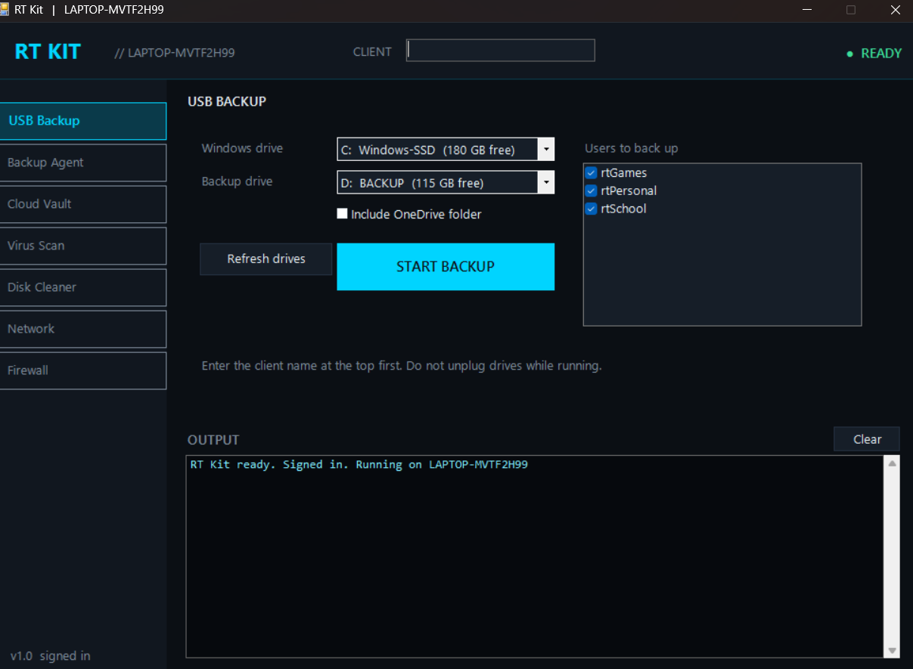
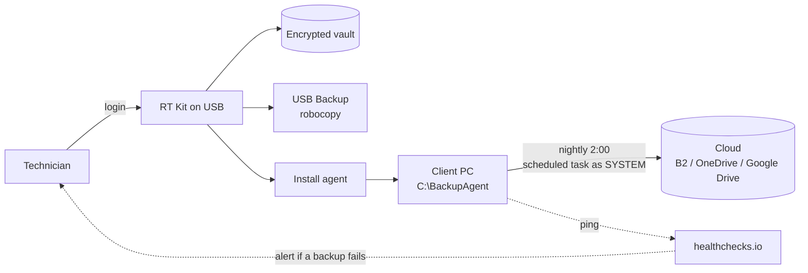

<p align="center">
  
</p>

<h1 align="center">RT Kit</h1>

<p align="center">
  A portable Windows toolkit for field IT support: client backups, a nightly cloud backup agent,<br>
  virus scanning, disk cleanup, network diagnostics and firewall control, behind one login.
</p>

<p align="center">
  
  
  
  
</p>

---

## Why I built it

I do PC repair and support on the side. Every job started the same way: back up the client's files, then fix the problem. Doing that by hand in Command Prompt was slow and easy to get wrong, especially when Windows wouldn't boot.

RT Kit turns that routine into a repeatable system that runs from a USB drive. It also adds a **nightly cloud backup agent**, so a one-time repair can become a monthly backup service.



## Features

| Module | What it does |
| --- | --- |
| **USB Backup** | Copies selected user profiles to a USB drive with `robocopy` (backup mode, junction-safe, multithreaded). Skips caches and temp files, and saves the installed-program list and system info. |
| **Backup Agent** | Installs a scheduled task (runs as SYSTEM) that syncs user folders to the cloud every night with `rclone`. Changed or deleted files are kept 30 days for ransomware/accidental-delete recovery. Optional [healthchecks.io](https://healthchecks.io) alerts. |
| **Cloud Vault** | Stores each client's cloud credentials (rclone configs) **encrypted** on the USB, unlocked only by the technician's login. |
| **Virus Scan** | Microsoft Defender status, definition updates, quick / full / folder / offline scans, threat history. |
| **Disk Cleaner** | Temp files, Windows Update cache, Delivery Optimization, thumbnails, browser caches, Recycle Bin, DISM component cleanup. Reports space freed. |
| **Network** | Checks the adapter, DHCP, router, internet, DNS and HTTPS, then gives a plain-language diagnosis. One-click network reset. |
| **Firewall** | Status and on/off per profile (Domain / Private / Public), reset to defaults. Warns if you try to close RT Kit with the firewall off. |
| **Reports** | Every action writes a timestamped report per client. |
| **WinRE fallback** | `backup.bat` handles backups from the Windows Recovery Environment when Windows won't boot. |

## How it works



## Security design

- **Technician login:** PBKDF2-SHA256 (200,000 iterations, random salt). Only a verifier is stored, never the password.
- **Vault encryption:** AES-256-CBC with HMAC-SHA256 (encrypt-then-MAC), keys derived from the login. A wrong password or a tampered file is rejected.
- **On client PCs:** the agent folder is locked to `SYSTEM` and `Administrators` with `icacls`. It uses SIDs, so it works on English and French Windows.
- **Cloud side:** rclone `crypt` can encrypt files before they leave the client's PC.
- **Never committed:** `vault/`, `reports/`, the login file, `rclone.conf` and binaries are in `.gitignore`.

> RT Kit is a personal project, not audited security software. Use it on PCs you are authorized to service.

## Project structure

```
RTKit/
├── RTKit.ps1            # GUI app (WinForms)
├── RTKit.bat            # launcher (requests admin)
├── build-exe.ps1        # compiles RTKit.exe with ps2exe
├── backup.bat           # CLI backup for WinRE / no-GUI situations
├── agent/
│   ├── backup-agent.ps1     # nightly sync job (installed on client PCs)
│   └── uninstall-agent.ps1
├── tools/
│   ├── disk-clean.ps1
│   └── net-check.ps1
├── bin/                 # rclone.exe (not included, download separately)
├── vault/               # encrypted configs (local only, git-ignored)
└── reports/             # job reports (local only, git-ignored)
```

## Getting started

**Requirements:** Windows 10/11, PowerShell 5.1, admin rights, [rclone](https://rclone.org/downloads/) for the cloud features.

1. Download or clone this repo onto a USB drive.
2. Put `rclone.exe` in `bin/`.
3. Run `RTKit.bat` and create your technician login.
4. Optional: build a single executable with `build-exe.ps1` (uses [ps2exe](https://github.com/MScholtes/PS2EXE)).

### Typical client visit

1. Plug in the USB, run RT Kit and sign in, then type the client name.
2. **USB Backup:** pick the drives and users, then Start.
3. Fix the issue: scan, clean, check the network.
4. Optional: **Backup Agent > Install** for ongoing cloud backup.
5. Leave the client their reports from `reports/`.

If Windows won't boot, open **Advanced Startup > Command Prompt** and run `backup.bat` from the USB.

## Built with

- **PowerShell 5.1** and **Windows Forms** for the GUI
- **robocopy** for local backup
- **rclone** for cloud sync, versioning and encryption
- **Task Scheduler**, **Microsoft Defender** (MpCmdRun / Defender cmdlets), **NetSecurity** and **NetTCPIP** modules
- .NET cryptography (`Rfc2898DeriveBytes`, `Aes`, `HMACSHA256`)

## Skills demonstrated

Windows administration · PowerShell scripting and GUI · task automation · backup and recovery strategy · Windows Recovery Environment · NTFS permissions / ACLs · Microsoft Defender · TCP/IP troubleshooting · applied cryptography · cloud storage · documentation

## Roadmap

- [ ] Restore wizard (pick a date and folder, restore from cloud)
- [ ] Health dashboard across all clients
- [ ] French interface (bilingual EN/FR)
- [ ] Code-signed release
- [ ] Hardware report (SMART disk health, battery, RAM)

## License

MIT, see [LICENSE](LICENSE).

---

**Ryan Torres**, IT support student, Montréal · [LinkedIn](https://www.linkedin.com/in/jrt96/) · [Portfolio](https://96torj.github.io/)
